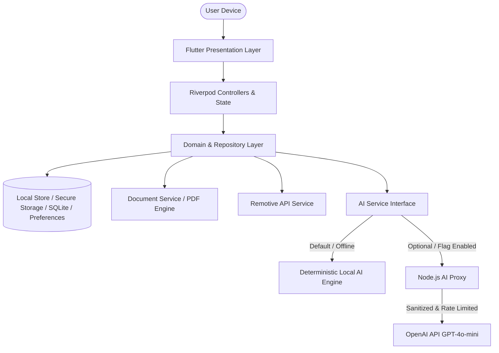

<div align="center">

# 🚀 VEYORA

### *Your Potential. Our Intelligence.*

An AI-powered career copilot built with **Flutter**, designed to empower job seekers through intelligent resume analysis, automated ATS scoring, tailored cover letters, targeted job matching, live remote listings, and interactive AI interview coaching.

[](https://flutter.dev)
[](https://dart.dev)
[](https://riverpod.dev)
[](#platform-support)
[](https://flutter.dev)
[](LICENSE)

</div>

---

## 📖 Table of Contents

- [Overview](#-overview)
- [Key Features](#-key-features)
- [Architecture & Flow](#-architecture--flow)
- [Tech Stack](#-tech-stack)
- [Getting Started](#-getting-started)
  - [Prerequisites](#prerequisites)
  - [Installation & Run](#installation--run)
  - [Pre-configured Demo Credentials](#pre-configured-demo-credentials)
- [Dual-Mode AI Engine](#-dual-mode-ai-engine)
  - [1. Offline Deterministic Local Engine](#1-offline-deterministic-local-engine-default)
  - [2. Cloud AI Proxy (Node.js + OpenAI)](#2-cloud-ai-proxy-nodejs--openai)
- [Project Directory Layout](#-project-directory-layout)
- [Testing & Quality Assurance](#-testing--quality-assurance)
- [Privacy & Security](#-privacy--security)
- [Contributing](#-contributing)
- [License](#-license)

---

## 🌟 Overview

**VEYORA** is a next-generation career copilot that bridges the gap between candidates and hiring systems. Many job applicants fail applicant tracking systems (ATS) due to poor formatting, missing keywords, or generic applications. 

VEYORA solves this by offering an all-in-one suite:
- **Zero-barrier operation**: Works out-of-the-box locally with zero external API keys needed.
- **Privacy-first**: All resume documents, profile data, match reports, and practice sessions remain strictly stored on-device.
- **Hybrid AI capabilities**: Switch seamlessly between a high-speed, offline heuristic AI engine and an optional enterprise OpenAI proxy backend.

---

## ✨ Key Features

### 📄 1. Resume Studio & Analyzer
- **Document Ingestion**: Supports uploading existing `.pdf` and `.docx` resumes with automated text extraction.
- **ATS Metric Scoring**: Breaks down score by structure, formatting, quantifiable achievements, and keyword density.
- **Skill Extraction & Gap Analysis**: Categorizes technical, soft, and domain skills; detects high-impact action verbs and warns on passive language.
- **Interactive Resume Builder**: Live editing with dynamic sections (Personal Info, Summary, Experience, Education, Skills) and real-time formatting.
- **Export & Share**: Generates cleanly styled, ATS-compliant PDF resumes with instant preview and device sharing.

### 🎯 2. Targeted Job Matcher
- **Job Description Parsing**: Paste any job description to evaluate your resume fit in seconds.
- **Match Breakdown**: Calculates overall match percentage, lists matched skills, identifies critical missing qualifications, and provides tailored alignment suggestions.

### ✍️ 3. AI Cover Letter Generator
- **Tailored Letters**: Automatically synthesizes resume highlights and target job requirements into compelling, professional cover letters.
- **In-App Editing & Export**: Edit with markdown support, copy to clipboard in one tap, or export directly to PDF.

### 💼 4. Remote Job Explorer
- **Live Listings**: Integrated directly with Remotive's live remote job feed.
- **Smart Filtering**: Search by job title, category (Software Development, Design, DevOps, Product, etc.), and location restrictions.
- **Saved Jobs**: Bookmark opportunities locally to revisit, analyze against your resume, or apply directly on original job boards.

### 🎙️ 5. AI Interview Coach
- **Simulated Sessions**: Practice role-tailored technical and behavioral interview questions.
- **Instant Structured Feedback**: Receive scored evaluations on clarity, relevance, confidence, and STAR-method alignment.
- **Model Answers**: Review high-impact benchmark answers to elevate your interview readiness.
- **Practice Tracking**: Track your interview session scores and progress history over time.

### 👤 6. User Profiles & Subscription Hub
- **Authentication**: Local-first authentication flow with pre-seeded demo mode and persistent session storage.
- **Subscription Plans**: Preview Free vs. Pro tier features, token quotas, and test-drive mock subscription management.
- **Adaptive UI**: Responsive shell providing a bottom navigation bar on mobile and an adaptive side rail on tablets/desktops, supporting both Light and Dark modes.

---

## 🏗️ Architecture & Flow

VEYORA follows **Clean Architecture** organized with a **Feature-First** structure.



### Clean Architecture Layers
- **Presentation (`presentation/`)**: Widgets, screens, responsive shells, and animation controllers.
- **Application (`application/`)**: Riverpod state notifiers, async controllers, and UI state abstractions.
- **Domain (`domain/`)**: Pure Dart entities, value objects, and business validation logic.
- **Data / Services (`data/`, `services/`)**: Local storage repositories, document parsers, remote REST clients, and AI dispatchers.

---

## 🛠️ Tech Stack

### Mobile Client (Flutter)
| Component | Technology / Library |
| :--- | :--- |
| **Framework** | Flutter 3.41+ / Dart 3.11+ |
| **State Management** | `flutter_riverpod` (v2.6+) |
| **Routing** | `go_router` (v17.5+) with `StatefulShellRoute` |
| **Styling & Icons** | Custom Theme System, Google Fonts, `cupertino_icons`, `flutter_animate` |
| **Persistence** | `shared_preferences`, `flutter_secure_storage` |
| **Document Processing**| `syncfusion_flutter_pdf`, `pdf`, `printing`, `archive` |
| **Networking** | `http`, `url_launcher` |
| **Data Visualization** | `fl_chart` |

### Backend AI Proxy (Node.js)
| Component | Technology |
| :--- | :--- |
| **Runtime** | Node.js (>= 18, ESM) |
| **Architecture** | Lightweight native HTTP proxy with rate limiting |
| **Model** | OpenAI (`gpt-4o-mini` with JSON mode) |
| **Security** | Shared Bearer token authorization, per-IP rate limiting, 2 MB payload cap |

---

## 🚦 Getting Started

### Prerequisites
- [Flutter SDK](https://docs.flutter.dev/get-started/install) (`^3.41.0` or compatible)
- [Dart SDK](https://dart.dev/get-dart) (`^3.11.4` or compatible)
- Xcode (for iOS simulator/device) and Android Studio (for Android emulator/device)
- Node.js (v18+) *[optional, only needed if running the OpenAI proxy]*

### Installation & Run

1. **Clone the repository**:
   ```bash
   git clone git@github.com:trydigital2/veyora.git
   cd veyora
   ```

2. **Install Flutter dependencies**:
   ```bash
   flutter pub get
   ```

3. **Launch the application**:
   ```bash
   flutter run
   ```
   *The app boots directly in offline-first mode with all AI analysis powered by the built-in local engine!*

### Pre-configured Demo Credentials

To quickly explore all features without signing up from scratch, use the seeded demo account:

- **Email**: `demo@veyora.app`
- **Password**: `Demo1234`

*The demo account is pre-seeded with sample resume data, ATS analysis, job matching results, and active Pro tier privileges.*

---

## 🧠 Dual-Mode AI Engine

### 1. Offline Deterministic Local Engine (Default)
VEYORA includes an extensive, standalone rule and NLP engine in `lib/core/services/local_ai_engine.dart`:
- Comprehensive dictionary of 1,000+ technical, business, and soft skills.
- Action verb analyzer measuring leadership, impact, and quantifiable accomplishments.
- Section completeness and syntax verification.
- Contextual question banks for software engineering, design, management, and product roles.
- **Zero latency, zero cost, works 100% offline.**

### 2. Cloud AI Proxy (Node.js + OpenAI)
For deep semantic reasoning, natural language feedback, and dynamic cover letter synthesis, VEYORA can connect to a secure proxy that keeps your API keys safe from reverse engineering.

#### Step 1: Start the backend proxy
```bash
cd backend
cp .env.example .env
```

Edit `backend/.env` with your OpenAI credentials:
```env
PORT=8787
OPENAI_API_KEY=sk-your-openai-api-key-here
OPENAI_MODEL=gpt-4o-mini
AI_PROXY_TOKEN=your-custom-shared-secret-token
```

Start the server:
```bash
npm run start:env
```
Verify health:
```bash
curl http://localhost:8787/health
# Response: {"status":"ok","model":"gpt-4o-mini"}
```

#### Step 2: Run Flutter with proxy parameters
```bash
# For macOS / iOS Simulator:
flutter run \
  --dart-define=AI_PROXY_URL=http://127.0.0.1:8787 \
  --dart-define=AI_PROXY_TOKEN=your-custom-shared-secret-token

# For Android Emulator (10.0.2.2 maps to host localhost):
flutter run \
  --dart-define=AI_PROXY_URL=http://10.0.2.2:8787 \
  --dart-define=AI_PROXY_TOKEN=your-custom-shared-secret-token
```

---

## 📂 Project Directory Layout

```text
veyora/
├── android/                   # Native Android host project
├── ios/                       # Native iOS host project
├── lib/
│   ├── app.dart               # App entrypoint, MaterialApp & theme routing
│   ├── main.dart              # SharedPreferences bootstrap & ProviderScope
│   ├── core/
│   │   ├── config/            # AppConfig and environment parameters
│   │   ├── providers.dart     # Global dependency injection providers
│   │   ├── router/            # GoRouter configuration & responsive shell
│   │   ├── services/          # DocumentService, AIService, LocalAiEngine
│   │   ├── settings/          # User preferences & theme state
│   │   ├── storage/           # Local store abstraction & persistence
│   │   ├── theme/             # Color palettes, typography, component themes
│   │   ├── utils/             # Formatters, validators, and helper utilities
│   │   └── widgets/           # Reusable UI kit (buttons, inputs, cards, dialogs)
│   └── features/
│       ├── auth/              # Authentication, login, signup, profile setup
│       ├── home/              # Dashboard, career momentum, quick actions
│       ├── interview/         # AI interview coach, mock sessions, results
│       ├── jobs/              # Remotive API feed, job details, saved jobs
│       ├── onboarding/        # Animated splash & introduction walkthrough
│       ├── profile/           # User profile, settings, and subscription tier
│       └── resume/            # Analyzer, builder, job matcher, cover letter
├── backend/                   # Node.js OpenAI Secure Proxy
│   ├── server.mjs             # Proxy server, task prompts, validation
│   ├── package.json           # Backend scripts and dependencies
│   ├── .env.example           # Backend environment template
│   └── README.md              # Backend documentation
├── test/
│   ├── widget_test.dart       # App startup & navigation smoke tests
│   └── unit/                  # Unit tests for validators & LocalAiEngine
├── analysis_options.yaml      # Dart analysis and linter configuration
└── pubspec.yaml               # Flutter package configuration & dependencies
```

---

## 🧪 Testing & Quality Assurance

Maintain code quality and verify integrity using the Flutter toolchain:

```bash
# Run static code analysis
flutter analyze

# Run unit and widget tests
flutter test
```

### Test Coverage Highlights
- **`test/widget_test.dart`**: Verifies splash screen initialization, onboarding progression, and navigation sanity.
- **`test/unit/validators_test.dart`**: Ensures strict validation for emails, passwords, and user input fields.
- **`test/unit/local_ai_engine_test.dart`**: Verifies scoring consistency, skill extraction algorithms, and heuristic accuracy.

---

## 🛡️ Privacy & Security

- **Local Storage by Default**: Resumes, parsed text, match scores, cover letters, and interview sessions are stored on the local device.
- **No Client API Keys**: Never embed proprietary keys in mobile code; network AI passes only through the authenticated proxy.
- **Demo Billing**: Subscription screens and payment flows are simulated for demonstration; no real financial data or credit card processing is executed.
- **External Links**: Live job listings are sourced from Remotive; clicking "Apply" safely launches the verified employer's original listing via `url_launcher`.

---

## 🤝 Contributing

Contributions, bug reports, and feature proposals are welcome!

1. Fork the Project
2. Create your Feature Branch (`git checkout -b feature/AmazingFeature`)
3. Commit your Changes (`git commit -m 'feat: Add AmazingFeature'`)
4. Push to the Branch (`git push origin feature/AmazingFeature`)
5. Open a Pull Request

---

## 📄 License

This project is licensed under the [MIT License](LICENSE) - see the LICENSE file for details.

---

<div align="center">
  <sub>Built with ❤️ by the VEYORA team.</sub>
</div>
